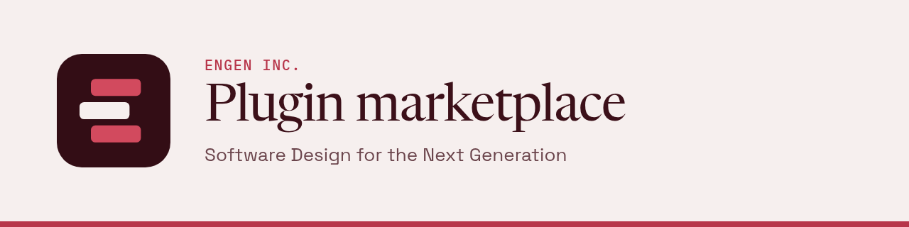

<p align="center"></p>

# Engen Inc. plugin marketplace

Plugins from Engen Inc. for Claude Code, GitHub Copilot, Codex and pi, published as one marketplace named `engen-tech`. Claude Code and Copilot read `.claude-plugin/marketplace.json`, Codex reads `.agents/plugins/marketplace.json`, and pi installs the whole repo as a package through `package.json`.

Releases arrive only as `release: <plugin> <version>` commits, pushed by the pipeline of the product repo that owns the plugin. Nobody edits `plugins/`, the catalogs, `package.json` or `plugins.lock.json` by hand: every release checks the whole tree and fails on a hand edit. [docs/design.md](docs/design.md) describes the release pipeline.

## Plugins

| Plugin | What it does | Harnesses |
|-|-|-|
| `plainlanguage` | Writing skill: a pass that removes the marks of generated text, plain-language rules, and the ASD-STE100 register for procedures. Released from the Forgejo repo common-skills. | Claude Code, Copilot, Codex, pi |
| `steward-prose-gate` | Blocks a reply or a `gh pr create`/`edit` body that reads like AI-generated text and asks for a plain-language revision. | Claude Code, Copilot, Codex, pi |
| `steward-delegation` | The delegation edict: pinned subagent profiles chosen by task complexity, and a gate that denies a second direct edit on the main thread. | Claude Code, Copilot, Codex, pi |
| `steward-orchestration` | Primary and secondary session roles for work that spans several sessions, with a shared registry of who directs whom. | Claude Code only |

## Install

Install only the plugins in your set (see [Plugin sets](#plugin-sets)).

```
# Claude Code (each CLAUDE_CONFIG_DIR profile)
claude plugin marketplace add https://github.com/Engen-Tech/plugin-marketplace.git
claude plugin install plainlanguage@engen-tech --scope user
claude plugin install steward-prose-gate@engen-tech --scope user
claude plugin install steward-delegation@engen-tech --scope user
claude plugin install steward-orchestration@engen-tech --scope user
# GitHub Copilot (close running sessions first)
copilot plugin marketplace add Engen-Tech/plugin-marketplace
copilot plugin install plainlanguage@engen-tech
copilot plugin install steward-prose-gate@engen-tech
copilot plugin install steward-delegation@engen-tech
# Codex (then trust each plugin's hooks once with /hooks)
codex plugin marketplace add Engen-Tech/plugin-marketplace
codex plugin add plainlanguage@engen-tech
codex plugin add steward-prose-gate@engen-tech
codex plugin add steward-delegation@engen-tech
# pi
pi install npm:pi-subagents
pi install git:github.com/Engen-Tech/plugin-marketplace
```

Use the HTTPS URL for Claude Code. An SSH clone breaks `claude plugin update`.

## Plugin sets

| You want | Install |
|-|-|
| Plain prose | plainlanguage, steward-prose-gate |
| Delegation | plainlanguage, steward-delegation; add steward-prose-gate to enforce the prose half of the edict |
| Orchestration (Claude Code) | all four |

## Notes per harness

**Codex.** Open `/hooks` once and trust the hooks of each plugin you installed. `codex exec` skips the hooks of an untrusted plugin and does not tell you.

**Copilot.** Copilot reads the same catalog as Claude Code, so it lists `steward-orchestration`. That plugin works on Claude Code only; do not install it on Copilot.

**pi.** `pi install` adds the whole package. To load only part of it, replace the package entry in your pi settings with one of these filters (both checked live on 2026-10-25):

- Prose gate only:

  ```json
  {"source": "git:github.com/Engen-Tech/plugin-marketplace", "extensions": ["plugins/steward-prose-gate/pi/extensions/steward-prose-gate/index.ts"], "skills": []}
  ```

- Everything except plainlanguage (the `/**` is required):

  ```json
  {"source": "git:github.com/Engen-Tech/plugin-marketplace", "skills": ["plugins/steward-delegation/pi/skills/**"]}
  ```

pi keeps the first skill it finds with a given name, and it reads `~/.agents/skills` before packages. So a plainlanguage copy you deployed there by hand hides the marketplace copy, with no warning. Delete the old copy to use the plugin.

**Skill preload.** The steward-delegation writer agent preloads plainlanguage. On Claude Code the agent gets the full text of the skill. On pi (pi-subagents 0.31.0 and later) it gets the skill's name, description and path, and reads the file itself.

## Soft dependencies

The steward-delegation edict and the prose-gate block messages name the plainlanguage skill. Both work without it. steward-orchestration tells you once when steward-delegation is missing.

## Coming from steward 0.14.2

The steward README has the migration steps for each harness: <https://github.com/TejGandham/steward#readme>.

## License

Engen Inc. proprietary license; see [LICENSE](LICENSE). A paid license agreement with Engen Inc. overrides it.
